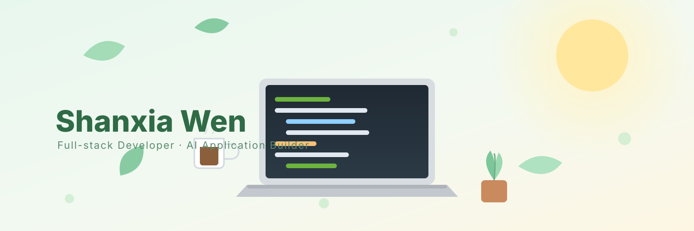

<!-- ✨ 顶部 banner（柔和薄荷绿 + 米色插画风，本地 SVG，零依赖） -->

<h3>👋 Hi there</h3>

你好，我是 **温珊霞（Shanxia Wen）** — 一名专注于 **全栈开发** 与 **AI 应用落地** 的计算机专业本科生。

我关注技术的最新进展，但更在意它能不能真正跑起来：把 Spring Boot 后端的交易一致性、权限鉴权、实时推送，连同 Vue / React 前端的交互体验，一点点拼成一个能交付、可维护的完整系统。从数据库设计到接口联调，从 Redis 缓存策略到 SSE 实时推送，从 AI Agent 的工具调用到权限边界——我更愿意亲手把链路跑通，再把踩过的坑沉淀成下一次的复用。

> 🧭 比起堆砌术语，我更想把想法变成能跑起来的东西。

> *I build full-stack products — and turn AI ideas into real, shippable features.*

---

## 🔧 我正在做什么

| 方向 | 实施内容 |
| :--- | :--- |
| 🤖 **AI Agent 应用落地** | 用 **Spring Boot + LangChain4j + 通义千问** 搭建采购智能体，覆盖发票、订单、库存、结算等业务工具，并以 DFA 做输入校验 |
| 🌐 **全栈产品开发** | 用 **Spring Boot + Vue / React** 独立完成助农电商等系统：交易与库存一致性、RBAC 权限、ECharts 数据看板 |
| 🧱 **工程基础与成长** | 持续打磨算法与计算机基础，在解决真实问题中学习；已通过 **软考中级 · 软件设计师** |

---

## 📂 代表项目 / Featured Projects

**🛒 NanaAgo · 助农电商平台** `Spring Boot + Vue + MyBatis-Plus`
面向农产品的全栈电商系统：Redis 缓存 + 支付宝异步回调防超卖、Sa-Token 权限体系、采购到售后的全链路追溯、ECharts 多维数据看板。

**🤖 AI Agent 采购管理系统** `Spring Boot + LangChain4j + React`
AI 对话智能体驱动的采购系统：5 个业务工具接入、7 条可配置预警规则 + SSE 实时推送、模糊三联发票匹配、状态机 + 乐观锁保证链路稳定。

**📝 NanaTodo · 任务管理应用** `Vue.js`
轻量级待办应用，我在 GitHub 上的第一个开源项目，仍在持续打磨中 🌱

---

## 🛠 常用技术

---

## 🧿 联系我

欢迎交流全栈开发与 AI Agent 落地，也欢迎**校招 / 实习**机会。

📮 邮箱：**3163350557@qq.com**
💬 微信：**wensh**

---

### 你好，我是 温珊霞 👋

  
  
  

---

## 🚀 GitHub Overview

  
  

  

  

---

## 🏆 一些小标签

  
  
  

---

⭐ 感谢访问！欢迎逛逛我的仓库，喜欢的话点个 Star

Last updated: 2026 · Made with ☕ and a lot of console.log

